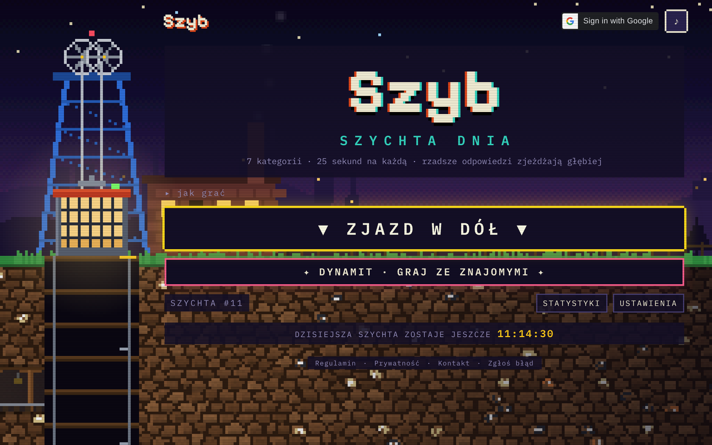
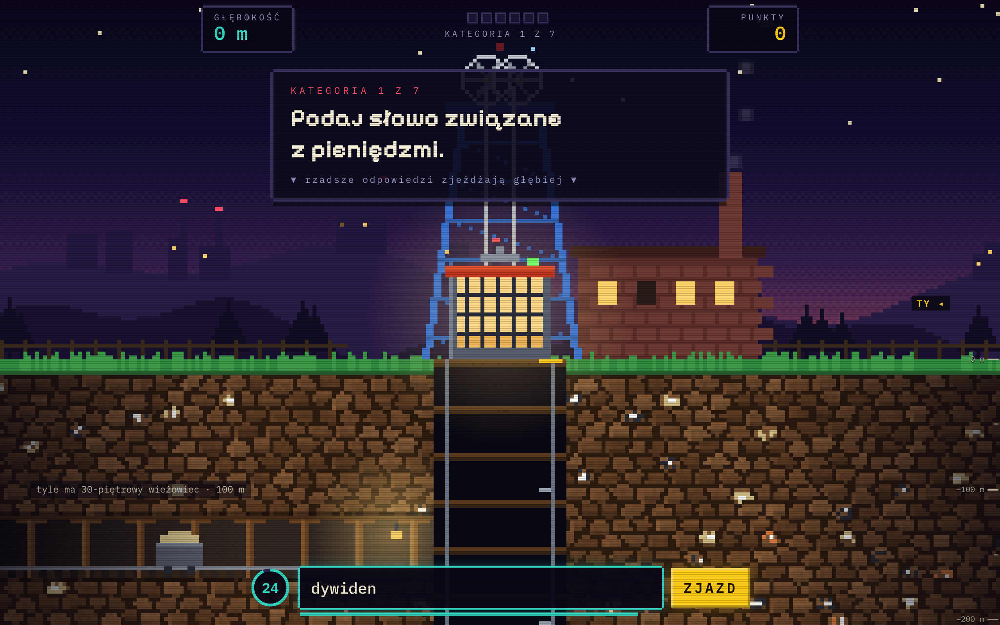
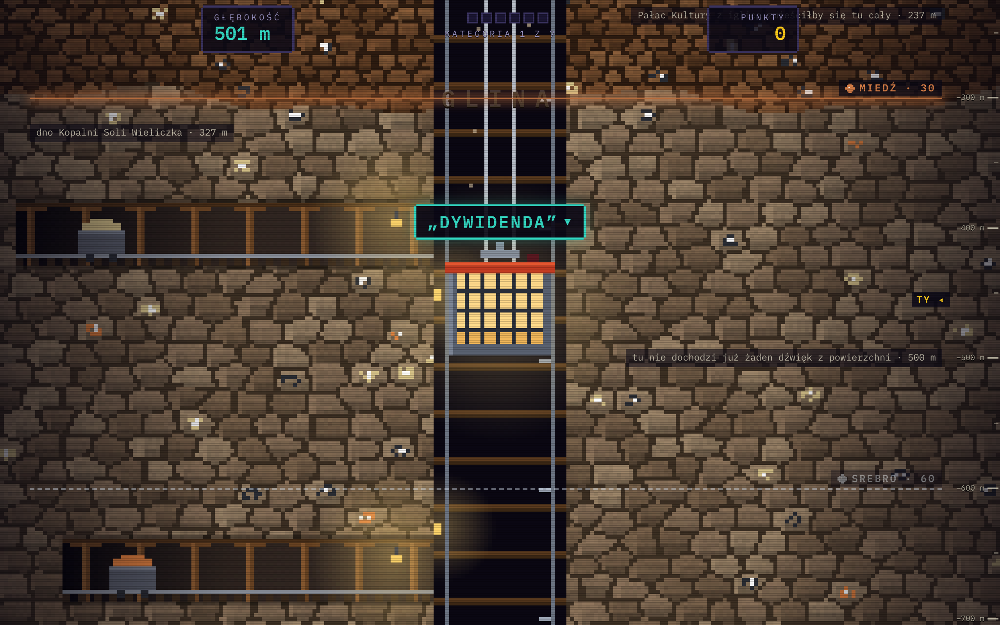
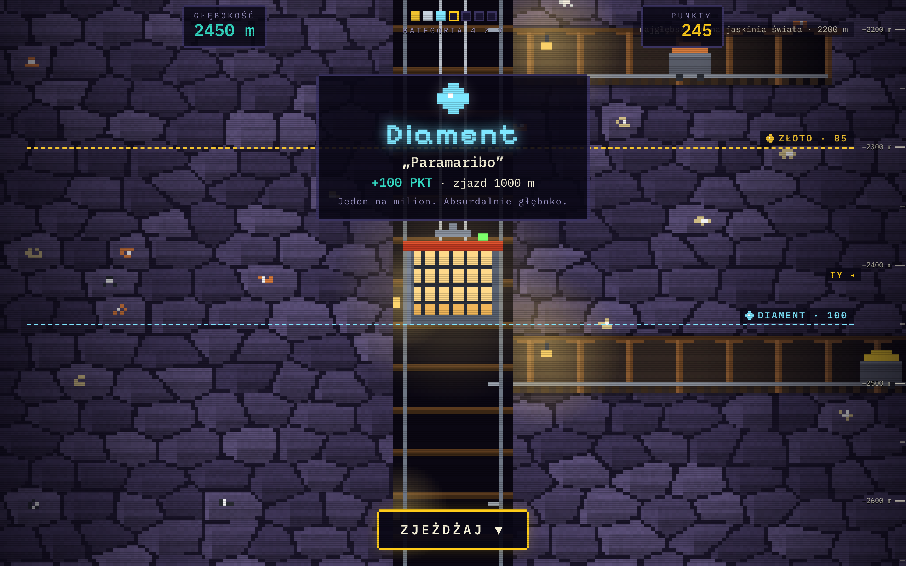
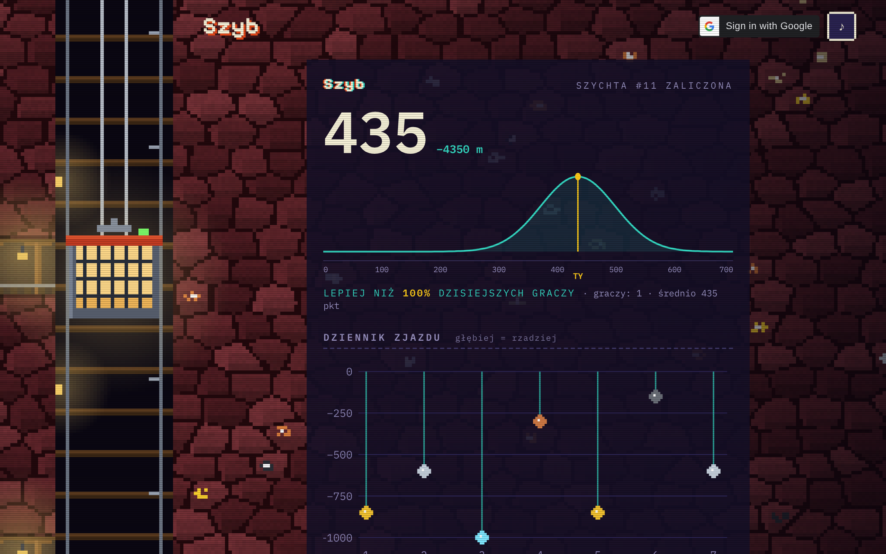
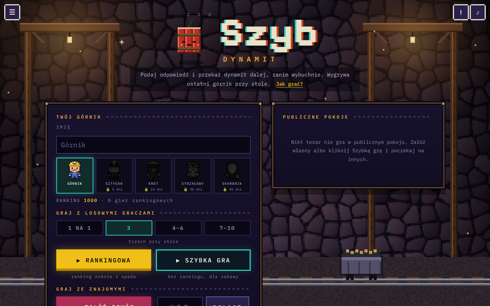
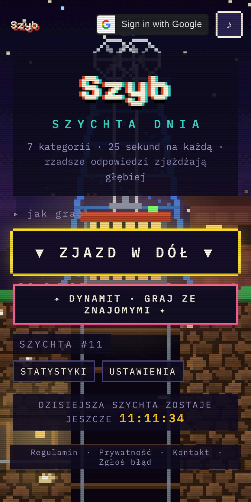
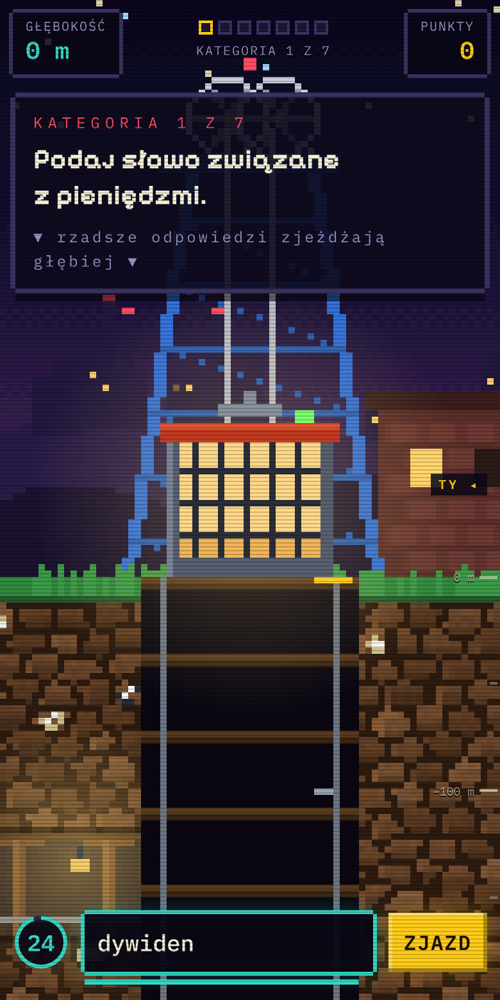
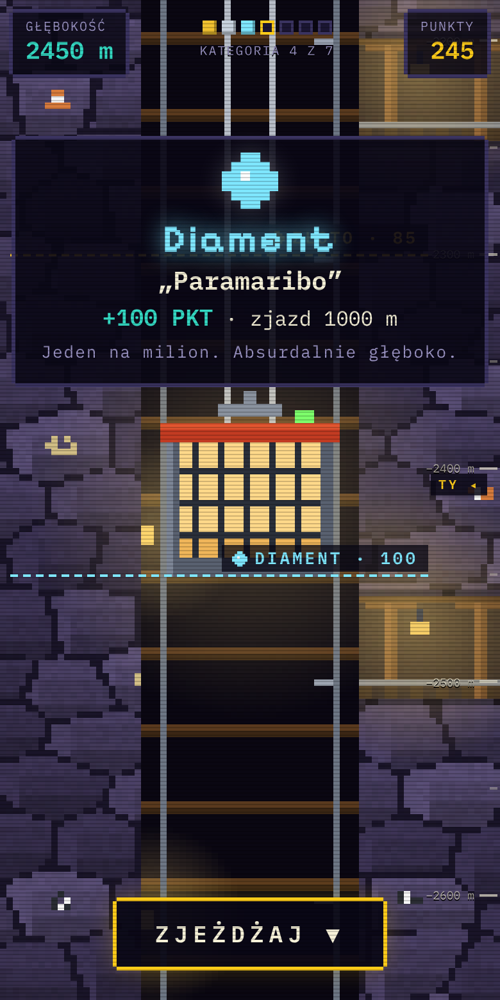
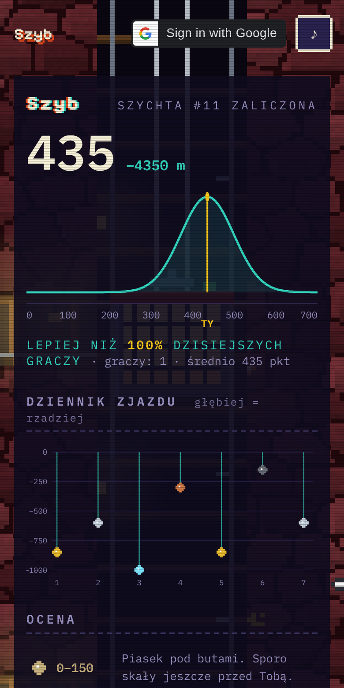

# Szyb ⛏️

**Codzienna polska gra słowna.** Gra na żywo: [szyb.app](https://szyb.app)

*English version below.*



Dostajesz kategorię (np. „Podaj wędlinę lub kiełbasę”) i 25 sekund. Każda poprawna odpowiedź się liczy, ale im rzadsza, tym głębiej zjeżdża winda: oczywista odpowiedź to Piasek, a te, na które wpada mało kto, to Złoto i Diament.

## Jak się gra

- **Szychta dnia:** 7 kategorii dziennie, ten sam zestaw dla wszystkich, jedna próba na dobę (nowa o północy).
- **Pokłady i punkty:** Piasek 10 · Węgiel 15 · Miedź 30 · Srebro 60 · Złoto 85 · Diament 100 (1 pkt = 10 m zjazdu).
- **Wyrozumiały sędzia:** rozpoznaje odpowiedzi bez polskich znaków, w odmianie (gęsi → gęś), z literówkami i w dłuższej formie („szynka konserwowa” → szynka). Gdy pisownia się różni, pyta „Czy chodziło Ci o…?”.
- **Dynamit (/multi):** tryb dla 2–10 graczy na zmianę z lontem, sercami, kolejką rankingową (Elo) i pokojami prywatnymi.
- **Statystyki** wszystkich graczy dnia, wynik do skopiowania, logowanie Google (opcjonalne).

## Zrzuty ekranu

| Pytanie | Zjazd w dół |
|---|---|
|  |  |
| **Diament: najrzadsza odpowiedź** | **Wynik dnia** |
|  |  |

**Dynamit: tryb wieloosobowy**



**Na telefonie**

<p>




</p>

## Treść

- Ok. 390 kategorii i ok. 89 tys. odpowiedzi, w tym kategorie młodzieżowe (gry, esport, anime, seriale, slang).
- Harmonogram bez powtórek: każdego dnia inny zestaw, aż pula się wyczerpie.
- Diament to zawsze tylko 1–3 najmniej oczywiste odpowiedzi w kategorii.

## Panel autora

Pod tajnym adresem (zmienna `ADMIN_PATH`, chroniony hasłem `ADMIN_KEY`):

- propozycje pytań od graczy (przyjęte wchodzą do gry od jutra),
- zgłoszenia błędów ze zrzutami ekranu,
- **brakujące odpowiedzi:** to, co gracze wpisują, a gra nie zna, z liczbą osób; jednym kliknięciem dopisuje się je do bazy i działają od razu.

## Technika

- Node.js 18+, **zero zależności** (`http`, `fs`, `crypto`); dane w jednym pliku JSON na trwałym dysku.
- Klient w czystym HTML/CSS/JS: pixel-artowy szyb rysowany na `<canvas>`, dźwięki 8-bit przez WebAudio, czcionki serwowane lokalnie.
- Wspólny moduł oceniania (`shared/judge.js`) działa w przeglądarce i na serwerze; wynik i tak liczy serwer, więc nie da się go podrobić.
- Bezpieczeństwo: limity żądań na IP, nagłówki CSP, porównanie hasła w stałym czasie, adres e-mail z Google nie jest zapisywany.
- Hosting: Railway + Cloudflare.

## Uruchomienie

```
node server.js
```

Potem otwórz http://localhost:3000. Opcjonalne zmienne: `PORT`, `DATA_DIR`, `ADMIN_KEY`, `ADMIN_PATH`, `GOOGLE_CLIENT_ID`, `CANONICAL_HOST`, `TZ`.

## Struktura

- `server.js`: serwer HTTP, API, panel autora.
- `multi.js`: tryb Dynamit.
- `shared/data.js`: kategorie bazowe i pokłady; `shared/cats.js`: pozostałe kategorie (generowane).
- `shared/judge.js`: ocenianie odpowiedzi i dzienny harmonogram.
- `public/`: klient gry.
- `tools/kategorie/`: źródła kategorii (`b*.txt`, rozszerzenia `x*.txt`) i `build.js`, który generuje `shared/cats.js` i pilnuje m.in. limitu diamentów.

---

# Szyb ⛏️ (English)

**A daily Polish word game.** Live at [szyb.app](https://szyb.app)

You get a category (e.g. "Name a cold cut or sausage") and 25 seconds. Any correct answer counts, but the rarer it is, the deeper your mine elevator goes: obvious answers are Sand, the ones few people think of are Gold and Diamond.

- **Daily shift:** 7 categories a day, the same set for everyone, one attempt per day.
- **Tiers:** Sand 10 · Coal 15 · Copper 30 · Silver 60 · Gold 85 · Diamond 100 points.
- **Forgiving judge:** accepts answers without Polish diacritics, in inflected forms, with typos and longer variants, asking "Did you mean…?" when spelling differs.
- **Dynamite (/multi):** a 2–10 player turn-based mode with a fuse, lives, Elo-ranked queue and private rooms.
- **Content:** ~390 categories and ~89k answers; Diamond is always just 1–3 of the least obvious answers.
- **Author panel:** player-suggested questions, bug reports with screenshots, and a "missing answers" list of what players typed that the game didn't know, addable to the game with one click.
- **Tech:** Node.js 18+ with zero dependencies, vanilla HTML/CSS/JS client with a pixel-art canvas shaft and 8-bit WebAudio sounds, shared judge module for client and server (scores are computed server-side), rate limiting and CSP. Hosted on Railway behind Cloudflare.

Screenshots are in the Polish section above (`docs/`).

Run locally with `node server.js` and open http://localhost:3000.

Made in Poland.
